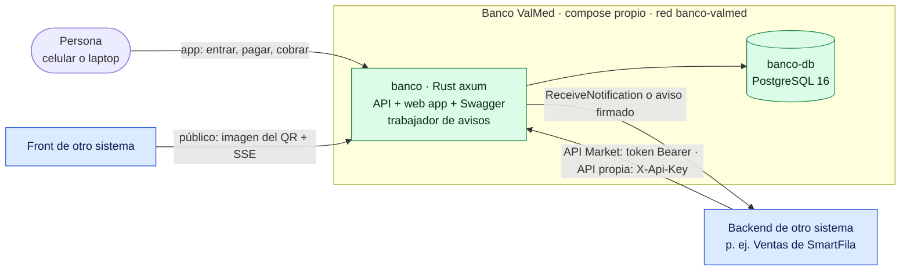
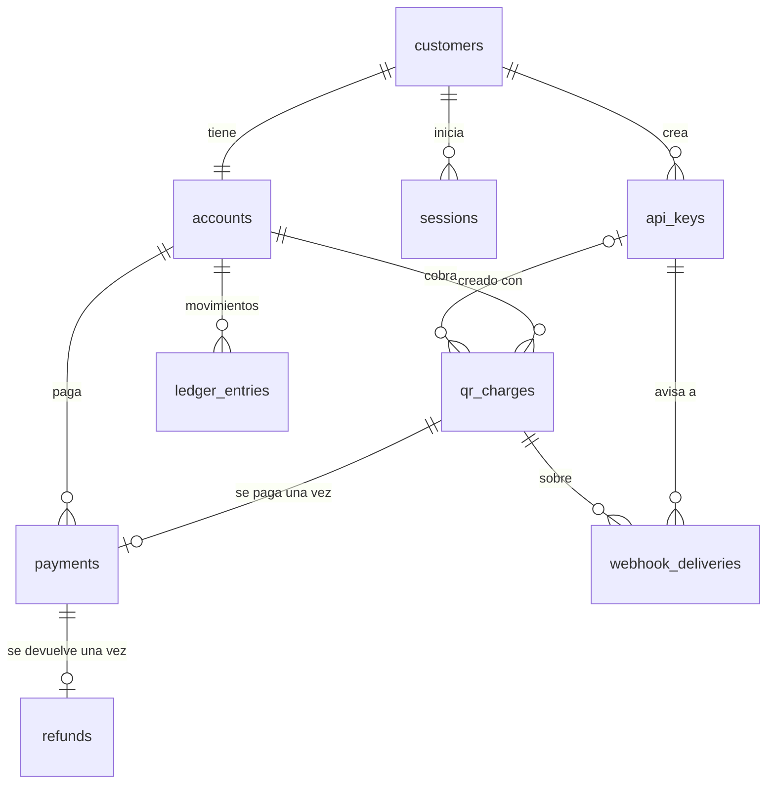
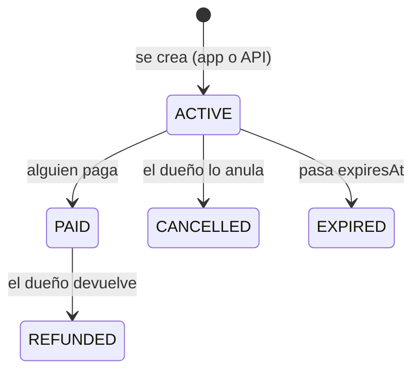
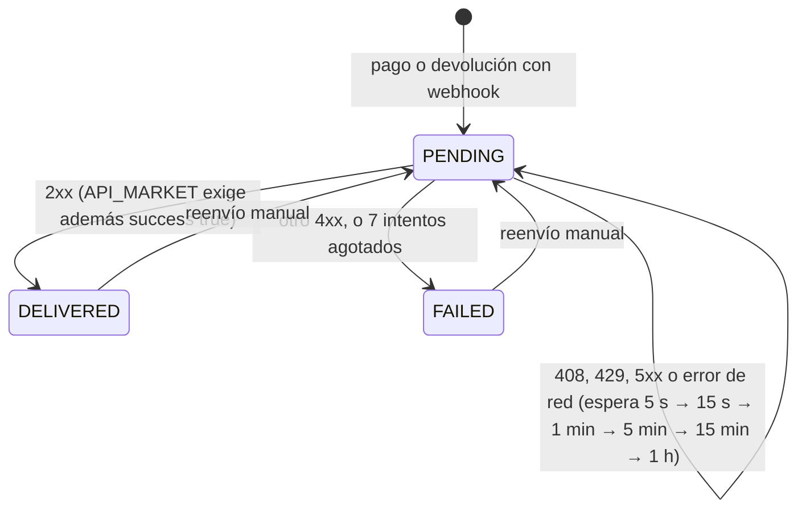

# Banco ValMed: diseño

> **Estado:** núcleo y API Market implementados (2026-11-18). **Sin dinero real.**
> Para integrarse: [API_MARKET_PAGO_QR.md](API_MARKET_PAGO_QR.md) (igual al BNB) o [GUIA_INTEGRACION.md](GUIA_INTEGRACION.md) (API propia). Para levantarlo: [README](../README.md).

## 1. Qué es y qué no es

Banco ValMed es un **banco simulado** que sirve para demostrar pagos con QR en proyectos como SmartFila. Hace cuatro cosas:

- **Genera QR dinámicos.** Cada QR tiene monto fijo, se paga una sola vez y vence. Lo puede crear cualquier cliente desde la app («Cobrar») o un sistema externo con clave de API.
- **Los QR se validan solos.** Cuando alguien paga, el estado cambia al instante para quien cobra, por SSE, por consulta y por un aviso firmado (webhook).
- **Simula una app de banco.** Se entra con C.I. y PIN; hay saldo, se escanea el QR con la cámara (o se escribe el código o se sube una foto), se confirma con el PIN y hay comprobante y movimientos.
- **Se puede pagar por API.** El sandbox permite pruebas automáticas sin la app.
- **Habla como el BNB.** La API Market copia rutas, campos y notificación de la API Market (Pago QR) del Banco Nacional de Bolivia, para que un integrador pueda pasar al banco real cambiando solo la URL y las credenciales.

Fuera de alcance: dinero real, otros bancos, el estándar EMVCo (por eso es un *pseudo* QR), KYC, otras monedas, varias cuentas por cliente, devoluciones parciales y comisiones.

Cómo lo consume cada sistema lo decide su equipo. El banco solo publica su contrato (OpenAPI + guía).

## 2. Decisiones

| # | Decisión | Por qué |
|---|---|---|
| D1 | Rust (axum 0.8, sqlx, utoipa) y PostgreSQL, en un compose propio (`banco` + `banco-db`) | Es el lenguaje del responsable; reusa el estilo de Identity (errores, Swagger, healthcheck sin curl). Puede correr solo, sin SmartFila |
| D2 | La web app es HTML/CSS/JS sin framework y la sirve el mismo contenedor | Se ve como otra aplicación, distinta del Angular de SmartFila. Sin build ni CDN; `jsQR` va copiado |
| D3 | Cuentas con saldo y PIN de 6 dígitos (Argon2id; 5 fallos → bloqueo de 5 min) | Permite demostrar saldo insuficiente, quién pagó y devoluciones |
| D4 | El QR lleva la URL `<base>/?p=<uuid>`, no el monto | La cámara normal abre la app. El monto está en el servidor, así que cambiar el QR no sirve de nada |
| D5 | Hay tres formas de enterarse del pago: SSE, consulta y webhook | SSE para que la pantalla «se autovalide»; webhook como fuente confiable para el backend; consulta como respaldo |
| D6 | El webhook usa outbox, HMAC-SHA256 y 7 intentos | El aviso nace en la misma transacción que el pago y nunca se pierde. La firma es el mismo modelo que usan las pasarelas reales |
| D7 | El banco solo mueve dinero; las reglas de negocio (pagador = titular, pago tardío) son del integrador | El aviso trae el C.I. del pagador; si no le sirve, el integrador devuelve el pago |
| D8 | Cualquier cliente puede crear claves de API («Desarrolladores») | No hace falta un alta de comercio: el equipo que integra abre su cuenta y crea su clave |
| D9 | Montos como string con 2 decimales; `numeric(14,2)` en la base | Ni Java, ni C#, ni JS pasan los montos por `float` |
| D10 | Además de la API propia, una **API Market compatible con el BNB** sobre los mismos cobros: `accountId`/`authorizationId` → JWT, id numérico, `{success, message}`, `ReceiveNotification` | Que la integración sobreviva al cambio a un banco real. Se copia también lo incómodo (HTTP 200 con `success: false`, vencimiento por día, notificación sin monto ni C.I.) para que el integrador lo resuelva desde el principio |
| D11 | Lo que el BNB no documenta se decide del lado conservador: solo `singleUse: true` y `BOB`; anulado = `statusId` 4; la notificación cuenta como entregada solo con `success: true` | Que nada que funcione en ValMed falle en el BNB por depender de algo que el BNB no promete |

## 3. Piezas

| Grupo de rutas | Autenticación | Quién lo usa |
|---|---|---|
| `/ClientAuthentication.API/api/v1/auth/…` | `accountId` + `authorizationId` en el cuerpo | Backend del integrador (API Market) |
| `/QRSimple.API/api/v1/main/…` | `Bearer` (JWT de 1 h) | Backend del integrador (API Market) |
| `/api/v1/qr`, `/api/v1/payments/…`, `/api/v1/webhook-deliveries` | `X-Api-Key` | Backend del integrador (API propia) |
| `/api/v1/public/qr/{id}` (+ `image.png`, `image.svg`, `events`) | ninguna (UUID v4), CORS `*` | Cualquier front |
| `/api/v1/sandbox/qr/{id}/pay` | `X-Api-Key` o JWT de la API Market, y `BANK_SANDBOX=true` | Pruebas automáticas |
| `/api/v1/app/…` | `Bearer` (token opaco de sesión) | Web app del banco |
| `/health`, `/api/v1/config`, `/docs` | ninguna | Docker, web app, personas |

Código:

| Carpeta | Contenido |
|---|---|
| `src/dominio/` | Reglas puras: C.I., montos, PIN, código corto, voucher, firma y reglas de la API Market (fechas de Bolivia, `statusId`, campos tolerantes) |
| `src/servicio/` | Casos de uso con SQL: clientes, cobros, claves, avisos, API Market y datos semilla |
| `src/api/` | Handlers, extractores y contrato OpenAPI (`market.rs` = API Market) |
| `src/infra/` | Argon2, tokens, JWT e imagen del QR |
| `static/` | Web app |
| `migrations/` | Esquema |

## 4. Modelo de datos

| Tabla | Clave | Restricciones que importan |
|---|---|---|
| `customers` | C.I. + complemento, nombre, `pin_hash`, fallos, `locked_until`, `google_sub` (reservado) | `UNIQUE NULLS NOT DISTINCT (ci_number, ci_complement)` |
| `accounts` | `number` `1001-000001`, `balance numeric(14,2)` | `CHECK (balance >= 0)`, una por cliente |
| `sessions` | `token_hash` (SHA-256), `last_seen_at`, `expires_at` | 15 min sin uso o 2 h en total |
| `api_keys` | `key_hash`, `prefix`, `webhook_url`, `webhook_secret`, `market_account_id`, `market_secret_hash` | Máximo 10 activas por cliente; `UNIQUE(market_account_id)` |
| `qr_charges` | `number` (id numérico = `qrId`), `code` (8 caracteres Crockford), monto, glosa, `metadata jsonb`, `additional_data`, `channel` (`APP`, `API`, `API_MARKET`), `status`, `expires_at` | `UNIQUE(code)`, `UNIQUE(number)`, `UNIQUE(account_id, merchant_reference)` |
| `payments` | `bank_reference` `VM-AAAAMMDD-NNNNNN`, `voucher_id` (10 caracteres), pagador, monto | `UNIQUE(qr_charge_id)`: un solo uso; `UNIQUE(voucher_id)` |
| `refunds` | motivo, monto | `UNIQUE(payment_id)`: solo devolución completa |
| `ledger_entries` | tipo, monto con signo, `balance_after`, contraparte | Saldo de la cuenta = suma de sus movimientos |
| `webhook_deliveries` | `format` (`VALMED` o `API_MARKET`), `body text`, `status`, `attempts`, `next_attempt_at`, último HTTP, error y respuesta | Índice parcial de los pendientes |

## 5. Estados

`EXPIRED` no se guarda: se calcula como `ACTIVE` con `expires_at <= now()`. Así no hace falta un proceso que barra los vencidos.

## 6. Pagar: una sola transacción

1. Se verifica el PIN **fuera** de la transacción, porque Argon2 tarda unos milisegundos.
2. `SELECT … FROM qr_charges WHERE id = $1 FOR UPDATE`: el cobro queda bloqueado. Se valida `ACTIVE`, que no haya vencido y que no sea de la propia cuenta.
3. Se bloquean las dos cuentas **en orden de id**, para que dos pagos cruzados no se bloqueen entre sí.
4. `UPDATE accounts SET balance = balance - $m WHERE id = $pagador AND balance >= $m`. Si no cambia ninguna fila, la respuesta es `INSUFFICIENT_FUNDS` y no cambió nada.
5. Se acredita al dueño del cobro y se insertan el pago, el cobro en `PAID` y dos movimientos.
6. Si el cobro salió de una clave con webhook, se inserta el **aviso** (outbox) con el cuerpo ya serializado.
7. `COMMIT`. Recién entonces se publica el evento en memoria (`tokio::broadcast`), que alimenta los SSE abiertos.

Si la misma cuenta repite el pago de un QR que ya pagó, recibe 200 con el mismo comprobante, así un doble toque no cobra dos veces. Las devoluciones siguen el mismo esquema en sentido contrario y también son idempotentes.

Verificado en la prueba de punta a punta:
- de 12 pagos simultáneos al mismo QR, 1 recibe 201 y 11 reciben 409;
- el saldo de cada cuenta es igual a la suma de sus movimientos;
- el dinero total es igual a la suma de aperturas y depósitos.

## 7. Avisos (webhook)

- El trabajador corre dentro del mismo proceso. Cada segundo toma hasta 10 avisos con `FOR UPDATE SKIP LOCKED` y les pone un *lease* de 30 s: si el proceso muere a mitad, el aviso se vuelve a tomar.
- La firma es `sha256=hex(HMAC_SHA256(secreto, timestamp + "." + cuerpo))`, en las cabeceras `X-ValMed-*`. Hay un vector de prueba compartido con la guía (`dominio/firma.rs`).
- Timeout de 5 s, sin seguir redirecciones. La URL del aviso se copia al momento del pago: cambiar el webhook de la clave no altera los avisos ya creados.
- El formato depende de por dónde se creó el cobro (`qr_charges.channel`). Los de la API Market mandan solo el pago, con el cuerpo `ReceiveNotification` del BNB (`QRId`, `Gloss`, `sourceBankId`, `originName`, `VoucherId`, `TransactionDateTime`, `additionalData`); las cabeceras `X-ValMed-*` van igual, pero son opcionales. Se guarda el inicio de la respuesta (`last_response`), que es el `notificationResponse` de la API Market.

## 8. Seguridad

| Riesgo | Medida |
|---|---|
| Adivinar el PIN | Argon2id; 5 fallos seguidos → bloqueo de 5 min (`ACCOUNT_LOCKED`) |
| Descubrir qué C.I. tienen cuenta | Un C.I. inexistente se verifica igual contra un hash ficticio, así tarda lo mismo y responde lo mismo |
| Robo de la base | Tokens de sesión, claves de API y `authorizationId` guardados como SHA-256 |
| Token de la API Market robado | JWT HS256 de 1 h firmado con `BANK_TOKEN_SECRET`; en cada uso se comprueba que la clave siga activa (revocar la clave corta el token) |
| Notificación de la API Market falsificada | Igual que en el BNB, no va firmada: la guía pide confirmar con `getQRStatusAsync` antes de entregar nada |
| Aviso falso al integrador | HMAC con secreto por clave, timestamp con ventana de 5 min del lado del integrador |
| Cambiar el monto del QR | El QR solo lleva un id; el monto está en el banco |
| Adivinar cobros | UUID v4 (122 bits). El código de 8 caracteres (40 bits) solo resuelve cobros activos y pide sesión |
| Pagar dos veces | `UNIQUE(qr_charge_id)` + bloqueo de fila |
| Host falso en las URL del QR | Solo se aceptan caracteres válidos de host y prefijo. Un nombre interno de Docker se cambia por `localhost:<puerto>` |
| Datos sensibles en logs | No se registran PIN, tokens, claves ni firmas; el C.I. va enmascarado (`7000***`) |
| Clave de API en un navegador | Las rutas con clave no tienen CORS; la guía indica usarlas solo desde el backend |

Riesgo aceptado: cualquier cliente puede registrar un webhook hacia cualquier URL (posible SSRF). En un banco de práctica dentro de Docker no importa; un banco real limitaría los destinos.

## 9. Siguiente fase: entrar con Google

Se puede agregar sin tocar lo existente: la columna `customers.google_sub` ya está reservada.

1. La app muestra «Continuar con Google» (Google Identity Services) solo si existe `GOOGLE_CLIENT_ID`.
2. `POST /api/v1/app/sessions/google {credential}`: el banco verifica el ID token con las claves públicas de Google (`aud`, `iss`, `exp`).
   - Si `sub` ya está vinculado, se crea la sesión.
   - Si no, la app pide **solo el C.I. y un PIN** (el nombre y el correo vienen de Google) y abre la cuenta.
3. **El PIN se sigue pidiendo para pagar.** Google reemplaza el paso de entrar, no la confirmación del pago, y el C.I. sigue siendo obligatorio porque los integradores lo reciben en `payer.ci`.

Lo que hace falta del lado de Google:
- un **OAuth Client ID** (tipo «Aplicación web») en Google Cloud Console, que solo lo puede crear el dueño de la cuenta;
- registrar cada **origen** desde el que se abre la app (`http://localhost:8086`, la URL del túnel). La URL de un túnel rápido de Cloudflare cambia en cada ejecución, así que conviene un túnel con nombre o una URL fija;
- que el contenedor tenga salida a internet para descargar las claves de Google.

## 10. Pendiente

- Entrar con Google (§9).
- API Market: QR de varios pagos (`singleUse: false`) y cuentas en USD, si algún integrador los necesita.
- Métricas y trazas (OpenTelemetry), si el curso lo pide para este componente.
- Pruebas de integración con base real (`#[ignore]`, como en Identity) para pago concurrente y devolución; hoy están cubiertas por la prueba de punta a punta con `curl`.
