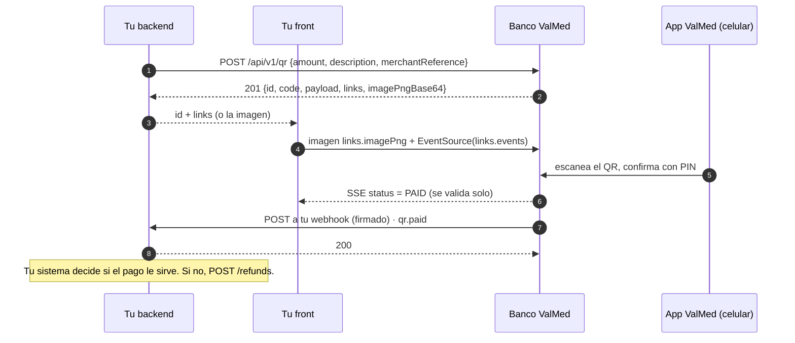

# Banco ValMed: guía de la API propia

Esta guía es para cualquier sistema que quiera **cobrar con QR** usando Banco ValMed, por ejemplo el microservicio de Ventas de SmartFila. Banco ValMed es un banco **simulado**: no mueve dinero real.

El banco ofrece **dos APIs** sobre los mismos cobros. Cuál usar lo decide cada equipo.

| | [API Market](API_MARKET_PAGO_QR.md) | API propia (esta guía) |
|---|---|---|
| Es igual a | La API Market (Pago QR) del **BNB** | Solo existe en ValMed |
| Para pasar al banco real | Cambias la URL y las credenciales | Hay que reescribir la integración |
| Credenciales | `accountId` + `authorizationId` → token Bearer | Cabecera `X-Api-Key` |
| Aviso de pago | Formato del BNB (`QRId`, `VoucherId`…) | Evento firmado con el cobro completo |
| Extras | — | Eventos en vivo (SSE), `merchantReference` idempotente, vencimiento en segundos, devoluciones, C.I. de quien pagó |

**Si el proyecto podría usar un banco real más adelante, empieza por la [API Market](API_MARKET_PAGO_QR.md).** Las dos APIs comparten la clave: la que creas en «Desarrolladores» sirve para ambas, y un QR de una API se puede consultar con la otra (`number` = `qrId`).

> Contrato completo: Swagger en `http://localhost:8086/docs` y el archivo [`openapi/banco-valmed.v1.yaml`](../openapi/banco-valmed.v1.yaml).

## Índice

1. [El flujo en un minuto](#1-el-flujo-en-un-minuto)
2. [Levantar el banco](#2-levantar-el-banco)
3. [Conseguir una clave de API](#3-conseguir-una-clave-de-api)
4. [Llamar al banco desde tu contenedor](#4-llamar-al-banco-desde-tu-contenedor)
5. [Crear un cobro QR](#5-crear-un-cobro-qr)
6. [Mostrar el QR](#6-mostrar-el-qr)
7. [Saber cuándo pagaron](#7-saber-cuándo-pagaron)
8. [Avisos firmados (webhook)](#8-avisos-firmados-webhook)
9. [Anular y devolver](#9-anular-y-devolver)
10. [Sandbox: pagar sin la app](#10-sandbox-pagar-sin-la-app)
11. [Errores](#11-errores)
12. [Reglas y límites](#12-reglas-y-límites)

---

## 1. El flujo en un minuto



1. Tu **backend** crea el cobro con su clave de API. El cobro tiene monto fijo, sirve una sola vez y vence.
2. Tu **front** muestra el QR. El QR lleva una URL a la app del banco, así que el celular la abre con la cámara normal.
3. La persona paga en la **app de Banco ValMed** con su cuenta y su PIN.
4. Te enteras del pago por **SSE en el navegador**, por **consulta** o por **aviso firmado** a tu backend. Puedes usar cualquiera de las tres o combinarlas.

## 2. Levantar el banco

```bash
cd banco-valmed
cp .env.example .env          # cambia BANK_DB_PASSWORD
docker compose up -d --build
```

| Qué | Dónde |
|---|---|
| App web del banco | http://localhost:8086 |
| Swagger | http://localhost:8086/docs |
| Desde otro contenedor | `http://banco:8080` (red Docker `banco-valmed`) |

**Cuentas de prueba** (todas con PIN `123456`):

| C.I. | Nombre | Saldo inicial |
|---|---|---|
| 7000001 | Rosa Quispe | Bs 2 000 |
| 7000002 | Juan Mamani | Bs 50 (para probar saldo insuficiente) |
| 7000003 | Luis Choque | Bs 1 000 |
| 7000004 | Carla Flores | Bs 1 000 |

Cualquiera puede abrir más cuentas desde la app; cada una nace con Bs 1 000. La app también tiene **Depositar** para cargar saldo.

## 3. Conseguir una clave de API

Una clave pertenece a una cuenta del banco: lo que cobras con ella entra a esa cuenta. Hay dos formas de conseguirla.

**A. Desde la app.** Entra con cualquier cuenta y ve a **Desarrolladores → Nueva clave de API**. Pon un nombre y, si quieres avisos, la URL de tu webhook. Se muestran **una sola vez**:
- la clave `vm_test_…`, que va en la cabecera `X-Api-Key`;
- el secreto `whsec_…`, que sirve para verificar la firma de los avisos.

En la misma pantalla puedes ver los avisos enviados, cuántos intentos llevan y su última respuesta, y reenviarlos.

**B. Fija en el `.env` del banco**, útil para que todo el equipo use la misma clave:

```env
BANK_SEED_API_KEY=vm_test_pon-aqui-un-valor-largo-y-aleatorio
BANK_SEED_WEBHOOK_SECRET=whsec_otro-valor-largo-y-aleatorio
BANK_SEED_WEBHOOK_URL=http://sales:8080/api/v1/ventas/pagos/notificaciones   # opcional
```

Esta clave pertenece a la cuenta «Comercio Demo» (C.I. 9000001, PIN 123456). Puedes generar valores con `openssl rand -base64 32 | tr '+/' '-_' | tr -d '='`.

> La clave de API es para tu **backend**. No la pongas en un front ni en un navegador.

## 4. Llamar al banco desde tu contenedor

El compose del banco crea la red `banco-valmed`. Únete a ella como red externa desde tu propio `docker-compose.yml`:

```yaml
services:
  sales:
    # …
    environment:
      BANK_BASE_URL: http://banco:8080
      BANK_API_KEY: ${BANK_API_KEY}
      BANK_WEBHOOK_SECRET: ${BANK_WEBHOOK_SECRET}
    networks: [default, banco-valmed]

networks:
  banco-valmed:
    external: true
```

Al estar en la misma red, el banco también llega a tu servicio por su nombre (`http://sales:8080/...`) para enviar los avisos.

Las URL que devuelve el banco (QR, imagen, eventos) **no** usan `banco:8080`, porque un celular no la puede abrir. Si llamas por la red interna, el banco usa `http://localhost:8086`. Para un celular por túnel, define `BANK_PUBLIC_URL` en el `.env` del banco (ver §6).

## 5. Crear un cobro QR

```http
POST /api/v1/qr
X-Api-Key: vm_test_…
Content-Type: application/json

{
  "merchantReference": "orden-6f1c2a9e-intento-1",
  "amount": "350.00",
  "description": "Entrada Guadalupe · Tramo A-014",
  "expiresInSeconds": 600,
  "metadata": { "ordenId": "6f1c2a9e" }
}
```

| Campo | Obligatorio | Regla |
|---|---|---|
| `amount` | sí | De 0.01 a 100000, máximo 2 decimales. Mándalo como **string** (`"350.00"`); también se acepta número |
| `description` | sí | 1 a 140 caracteres. Es lo que verá quien paga |
| `merchantReference` | no | Tu referencia, **única por cuenta**, hasta 100 caracteres. Si la repites con los mismos datos, devuelve el cobro que ya existe (200). Si la repites con otros datos, responde 409 |
| `expiresInSeconds` | no | De 30 a 86400. Si falta, 600 (10 min) |
| `expiresAt` | no | Fecha exacta (ISO-8601), de 30 s a 24 h desde ahora. No se puede usar junto con `expiresInSeconds` |
| `currency` | no | Solo `BOB` |
| `metadata` | no | Objeto JSON libre, de hasta 2000 bytes. Vuelve tal cual en las consultas y los avisos |

Respuesta **201**, o **200** si ya existía:

```json
{
  "id": "780f6851-80c4-4b18-bd60-fd9b0e34fcd4",
  "number": 51,
  "code": "DYSM-W8S5",
  "status": "ACTIVE",
  "amount": "350.00",
  "currency": "BOB",
  "description": "Entrada Guadalupe · Tramo A-014",
  "merchantReference": "orden-6f1c2a9e-intento-1",
  "metadata": { "ordenId": "6f1c2a9e" },
  "receiver": { "name": "Comercio Demo", "account": "****0005" },
  "createdAt": "2026-11-18T23:27:43.324367Z",
  "expiresAt": "2026-11-18T23:37:43.324268Z",
  "paidAt": null,
  "cancelledAt": null,
  "refundedAt": null,
  "payload": "http://localhost:8086/?p=780f6851-80c4-4b18-bd60-fd9b0e34fcd4",
  "links": {
    "imagePng": "http://localhost:8086/api/v1/public/qr/780f6851-…/image.png",
    "imageSvg": "http://localhost:8086/api/v1/public/qr/780f6851-…/image.svg",
    "status":   "http://localhost:8086/api/v1/public/qr/780f6851-…",
    "events":   "http://localhost:8086/api/v1/public/qr/780f6851-…/events"
  },
  "imagePngBase64": "iVBORw0KGgoAAAANSUhEUgAA…",
  "payment": null
}
```

- **Un QR por intento de pago.** Un cobro se paga una sola vez. Si después de una devolución la misma orden necesita cobrarse de nuevo, crea otro cobro con otra `merchantReference` (por ejemplo, `-intento-2`).
- `imagePngBase64` solo viene en la respuesta de creación. Después usa `links.imagePng`.
- `number` es el id numérico del QR: el mismo `qrId` de la [API Market](API_MARKET_PAGO_QR.md).

Prueba rápida:

```bash
curl -s -X POST http://localhost:8086/api/v1/qr \
  -H "X-Api-Key: $KEY" -H 'Content-Type: application/json' \
  -d '{"amount":"10.00","description":"Prueba"}' | jq '{id, code, payload}'
```

## 6. Mostrar el QR

Tienes tres opciones, de la más simple a la más manual:

```html
<!-- 1. Enlace público: no necesita clave y tiene CORS abierto -->


<!-- 2. Imagen que vino en la creación -->


<!-- 3. Generarlo tú con cualquier librería de QR, a partir de `payload` -->
```

También conviene mostrar:
- el **código** (`DYSM-W8S5`), para pagar sin cámara: en la app, **Pagar QR → Escribe el código**;
- un enlace «Abrir Banco ValMed» a `payload`, para pagar en el mismo dispositivo;
- una cuenta regresiva hasta `expiresAt`.

**Con celular y túnel.** La cámara del celular exige HTTPS. Expón el banco con un túnel:

```bash
cloudflared tunnel --url http://127.0.0.1:8086
```

Pon esa URL en el `.env` del banco (`BANK_PUBLIC_URL=https://xxxx.trycloudflare.com`) y reinicia con `docker compose up -d`. Desde ese momento los QR apuntan al túnel. Si no defines `BANK_PUBLIC_URL`, el banco arma la URL con la dirección por la que le llegó cada petición.

## 7. Saber cuándo pagaron

| Forma | Dónde | Para qué |
|---|---|---|
| **A. Eventos en vivo (SSE)** | Navegador o cualquier cliente HTTP | Que la pantalla cambie sola apenas pagan |
| **B. Consulta** | Backend (`GET /api/v1/qr/{id}`) o cualquiera (`links.status`) | Respaldo, o si no quieres SSE ni webhook |
| **C. Aviso firmado (webhook)** | Tu backend | Fuente confiable para confirmar la venta (§8) |

**A. SSE (el QR «se autovalida»).** El banco manda el estado actual y luego cada cambio, como eventos `status`. Cierra el flujo cuando el cobro queda `PAID`, `EXPIRED`, `CANCELLED` o `REFUNDED`.

```js
const eventos = new EventSource(cobro.links.events);
eventos.addEventListener('status', (e) => {
  const estado = JSON.parse(e.data);           // { id, code, status, amount, receiverName, expiresAt, paidAt, … }
  if (estado.status === 'PAID') mostrarPagado();
  if (estado.status !== 'ACTIVE') eventos.close();   // si no, el navegador se reconecta
});
```

El endpoint público **no** incluye datos de quién pagó. Para eso usa la consulta con clave o el aviso.

**B. Consulta.** `GET /api/v1/qr/{id}` con `X-Api-Key` devuelve el cobro completo. Si está pagado, `payment` trae `bankReference`, `voucherId` (código de 10 caracteres), `paidAt` y `payer` (`ci`, `name`, `account` enmascarada). Para buscar por tu referencia: `GET /api/v1/qr?merchantReference=orden-6f1c2a9e-intento-1`.

**Estados** (`status`):

| Estado | Significa |
|---|---|
| `ACTIVE` | Esperando pago |
| `PAID` | Pagado. Ya no se puede volver a pagar |
| `EXPIRED` | Venció sin pago |
| `CANCELLED` | Lo anulaste |
| `REFUNDED` | Se pagó y lo devolviste |

## 8. Avisos firmados (webhook)

Si tu clave tiene `webhookUrl`, el banco hace un `POST` a esa URL cuando un cobro hecho **con esa clave** se paga (`qr.paid`) o se devuelve (`qr.refunded`).

Los cobros creados con la API Market avisan solo el pago, con el formato del BNB ([ReceiveNotification](API_MARKET_PAGO_QR.md#11-notificación-de-pagos-qr-receivenotification)). Los creados con esta API usan el formato de esta sección.

**Cabeceras**

| Cabecera | Ejemplo |
|---|---|
| `X-ValMed-Event-Id` | `71fea57a-630d-4844-b116-4100933f631b` (igual a `id` del cuerpo; se repite en los reintentos) |
| `X-ValMed-Event` | `qr.paid` o `qr.refunded` |
| `X-ValMed-Timestamp` | `1795044469` (segundos Unix del envío) |
| `X-ValMed-Signature` | `sha256=62ddb2f5…` |

**Cuerpo** (aviso real, abreviado). `data` es el mismo objeto que devuelve `GET /api/v1/qr/{id}`:

```json
{
  "id": "71fea57a-630d-4844-b116-4100933f631b",
  "type": "qr.paid",
  "createdAt": "2026-11-18T23:27:44.551167348Z",
  "data": {
    "id": "780f6851-80c4-4b18-bd60-fd9b0e34fcd4",
    "code": "DYSM-W8S5",
    "status": "PAID",
    "amount": "350.00",
    "currency": "BOB",
    "description": "Entrada Guadalupe · Tramo A-014",
    "merchantReference": "orden-6f1c2a9e-intento-1",
    "metadata": { "ordenId": "6f1c2a9e" },
    "paidAt": "2026-11-18T23:27:44.544894Z",
    "payment": {
      "bankReference": "VM-20261118-000007",
      "voucherId": "3JAO702813",
      "amount": "350.00",
      "currency": "BOB",
      "paidAt": "2026-11-18T23:27:44.544894Z",
      "payer": { "ci": "7000002", "name": "Juan Mamani", "account": "****0002" },
      "refundedAt": null,
      "refundReason": null
    }
  }
}
```

**Verificar la firma.** Calcula `"sha256=" + hex(HMAC_SHA256(secreto, timestamp + "." + cuerpo))`:
- usa los **bytes crudos** del cuerpo, antes de deserializarlo;
- compara en tiempo constante;
- rechaza si `|ahora − timestamp| > 300 s`.

Vector de prueba: con el secreto `whsec_prueba`, el timestamp `1763490725` y el cuerpo `{"id":"evt_1"}`, la firma es `sha256=0a39d4ae3eb66f9599fc86e329b9352704d02a4ba76e8dba30c699b9f8022568`.

Java (Spring Boot):

```java
@PostMapping(value = "/api/v1/ventas/pagos/notificaciones", consumes = "application/json")
public ResponseEntity<Void> recibir(@RequestHeader("X-ValMed-Timestamp") long timestamp,
                                    @RequestHeader("X-ValMed-Signature") String firma,
                                    @RequestBody byte[] cuerpo) throws Exception {
    if (Math.abs(Instant.now().getEpochSecond() - timestamp) > 300) return ResponseEntity.status(401).build();
    Mac mac = Mac.getInstance("HmacSHA256");
    mac.init(new SecretKeySpec(secreto.getBytes(StandardCharsets.UTF_8), "HmacSHA256"));
    mac.update((timestamp + ".").getBytes(StandardCharsets.UTF_8));
    String esperada = "sha256=" + HexFormat.of().formatHex(mac.doFinal(cuerpo));
    if (!MessageDigest.isEqual(esperada.getBytes(StandardCharsets.UTF_8), firma.getBytes(StandardCharsets.UTF_8)))
        return ResponseEntity.status(401).build();
    JsonNode aviso = objectMapper.readTree(cuerpo);
    // Idempotente: si data.payment.bankReference ya está procesada, responde 200 sin hacer nada.
    return ResponseEntity.ok().build();
}
```

C# (ASP.NET Core):

```csharp
app.MapPost("/pagos/avisos", async (HttpRequest req) =>
{
    using var ms = new MemoryStream();
    await req.Body.CopyToAsync(ms);
    var cuerpo = ms.ToArray();
    var ts = req.Headers["X-ValMed-Timestamp"].ToString();
    var firma = req.Headers["X-ValMed-Signature"].ToString();
    if (!long.TryParse(ts, out var t) || Math.Abs(DateTimeOffset.UtcNow.ToUnixTimeSeconds() - t) > 300)
        return Results.Unauthorized();
    using var hmac = new HMACSHA256(Encoding.UTF8.GetBytes(secreto));
    var firmado = Encoding.UTF8.GetBytes(ts + ".").Concat(cuerpo).ToArray();
    var esperada = "sha256=" + Convert.ToHexString(hmac.ComputeHash(firmado)).ToLowerInvariant();
    if (!CryptographicOperations.FixedTimeEquals(Encoding.UTF8.GetBytes(esperada), Encoding.UTF8.GetBytes(firma)))
        return Results.Unauthorized();
    var aviso = JsonDocument.Parse(cuerpo);
    // Idempotente por data.payment.bankReference (o por X-ValMed-Event-Id).
    return Results.Ok();
});
```

**Tu respuesta indica si recibiste el aviso, no si te sirve el pago.** Si el pago no te sirve (por ejemplo, pagó otra persona o llegó tarde), responde **200** igual y luego pide la devolución (§9).

| Respondes | El banco |
|---|---|
| 2xx | Lo marca como entregado |
| 408, 429, 5xx, timeout (5 s) o conexión rechazada | Reintenta a los 5 s, 15 s, 1 min, 5 min, 15 min y 1 h (7 intentos en total) |
| Otro 4xx (400, 401…) | Lo marca como fallido y no reintenta. Lo ves en la app (Desarrolladores) |

- El mismo aviso puede llegar **más de una vez**, porque hay reintentos y reenvíos manuales. Procésalo de forma idempotente, por `data.payment.bankReference` o por `X-ValMed-Event-Id`.
- Cada reintento manda los **mismos bytes** de cuerpo, con timestamp y firma nuevos.
- Para probar la idempotencia, reenvía un aviso: `POST /api/v1/webhook-deliveries/{id}/redeliver`, o el botón **Reenviar** en la app. Con `GET /api/v1/webhook-deliveries` ves los avisos de tu clave.
- El aviso se guarda en la misma transacción que el pago, así que no se pierde aunque tu servicio esté caído.

## 9. Anular y devolver

**Anular** un cobro que nadie pagó:

```http
POST /api/v1/qr/{id}/cancel        → 200 (también si ya estaba anulado) · 409 QR_ALREADY_PAID / QR_EXPIRED
```

**Devolver** un pago completo a quien pagó. El dinero sale de tu cuenta, así que necesitas saldo:

```http
POST /api/v1/payments/VM-20261118-000007/refunds
X-Api-Key: vm_test_…
Content-Type: application/json

{ "reason": "PAGADOR_DISTINTO" }
```

- `reason` acepta `PAGADOR_DISTINTO`, `PAGO_TARDIO`, `MONTO_DISTINTO` o `DEVOLUCION` (el valor por defecto).
- Responde **201** con la devolución, o **200** si ya estaba devuelto: puedes repetir la llamada sin riesgo.
- El cobro pasa a `REFUNDED` y, si tu clave tiene webhook, llega un aviso `qr.refunded`.

## 10. Sandbox: pagar sin la app

Para pruebas automáticas, Postman o JMeter. Solo funciona con `BANK_SANDBOX=true`, que es el valor por defecto en el compose:

```http
POST /api/v1/sandbox/qr/{id}/pay
X-Api-Key: vm_test_…
Content-Type: application/json

{ "payerCi": "7000001" }
```

`{id}` puede ser el `id` del cobro o su `number`. En lugar de `X-Api-Key` también acepta el token de la API Market (`Authorization: Bearer …`).

Paga desde la cuenta de ese C.I., sin PIN. Si el C.I. no tiene cuenta, se le abre una con el saldo inicial y PIN 123456. Sigue las mismas reglas que un pago desde la app (saldo, vencimiento, un solo uso) y envía el mismo aviso.

Flujo completo por consola:

```bash
KEY=vm_test_…
QR=$(curl -s -X POST http://localhost:8086/api/v1/qr -H "X-Api-Key: $KEY" -H 'Content-Type: application/json' \
      -d '{"merchantReference":"prueba-1","amount":"350.00","description":"Prueba"}' | jq -r .id)
curl -s -X POST http://localhost:8086/api/v1/sandbox/qr/$QR/pay -H "X-Api-Key: $KEY" \
      -H 'Content-Type: application/json' -d '{"payerCi":"7000001"}' | jq .
curl -s http://localhost:8086/api/v1/qr/$QR -H "X-Api-Key: $KEY" | jq '{status, payment}'
```

## 11. Errores

Todas las respuestas de error tienen el mismo cuerpo, igual que en los servicios de SmartFila:

```json
{ "code": "INSUFFICIENT_FUNDS", "message": "Saldo insuficiente", "details": [], "traceId": "4bf92f35-…" }
```

`traceId` es igual a la cabecera `X-Correlation-Id`. Si mandas esa cabecera, el banco la reutiliza.

| HTTP | `code` | Cuándo |
|---|---|---|
| 400 | `VALIDATION_ERROR` | Datos inválidos; `details` dice qué campo y por qué |
| 401 | `UNAUTHENTICATED` | Falta `X-Api-Key`, o la clave es inválida o está revocada |
| 404 | `QR_NOT_FOUND` | El cobro no existe o es de otra cuenta |
| 404 | `PAYMENT_NOT_FOUND` | Esa `bankReference` no existe o no es tuya |
| 404 | `NOT_FOUND` | Ruta inexistente, o sandbox apagado |
| 409 | `MERCHANT_REFERENCE_CONFLICT` | Repetiste una `merchantReference` con otros datos |
| 409 | `QR_ALREADY_PAID` / `QR_EXPIRED` / `QR_CANCELLED` | El cobro ya no admite esa operación |
| 409 | `INSUFFICIENT_FUNDS` | Quien paga, o tu cuenta al devolver, no tiene saldo |
| 409 | `CANNOT_PAY_OWN_QR` | Se intentó pagar un cobro de la propia cuenta |
| 503 | `DEPENDENCY_UNAVAILABLE` | La base del banco no responde; reintenta |

## 12. Reglas y límites

- Moneda única: **BOB**. Montos con 2 decimales, enviados como string.
- Un cobro se paga **una sola vez**. Si dos personas pagan a la vez, gana una y la otra recibe `QR_ALREADY_PAID`.
- Vigencia de un cobro: de 30 s a 24 h. Las devoluciones son siempre por el monto completo.
- Cada cuenta puede tener hasta 10 claves activas, y revocar una la desactiva de inmediato.
- Los endpoints públicos (`/api/v1/public/qr/{id}`, imagen y eventos) no piden credenciales: el id es un UUID imposible de adivinar, y no muestran quién pagó.
- Fechas en ISO-8601 UTC. Las referencias del banco tienen la forma `VM-AAAAMMDD-NNNNNN`.
